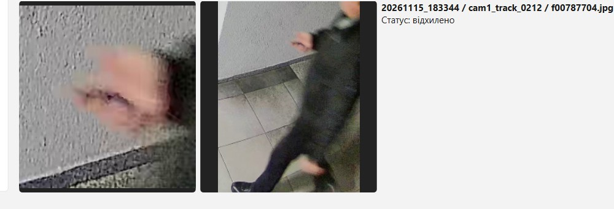
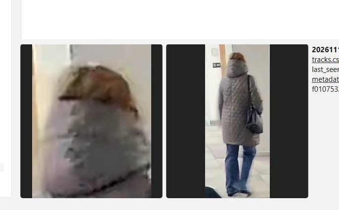
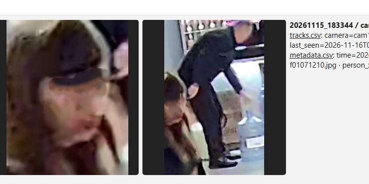
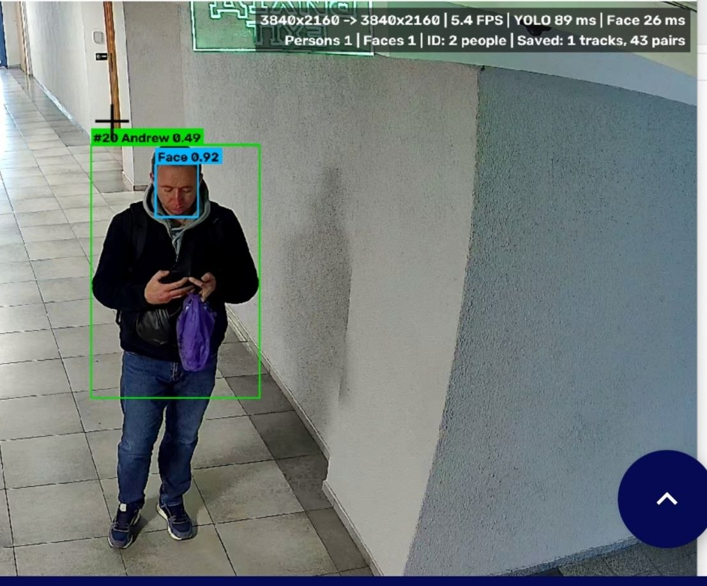
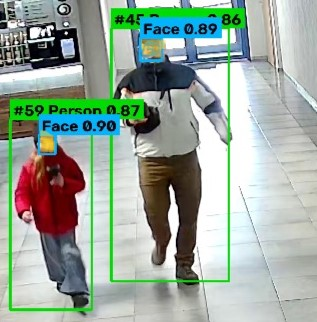

# Система виявлення, відстеження та розпізнавання людей у відеопотоці з використанням методів Computer Vision

## 1. Motivation — Мотивація та постановка задачі

Сучасні системи відеоспостереження переважно використовуються для запису та перегляду відеоінформації. Однак звичайне відеоспостереження потребує участі оператора для аналізу подій, пошуку людей та визначення їхньої особи.

Завдяки розвитку комп'ютерного зору та нейронних мереж з'явилася можливість автоматизувати ці процеси.

**Мета курсового проєкту** — розробити систему, яка автоматично аналізує відеопотік IP-камери, виявляє людей, відстежує їх між кадрами, знаходить обличчя та визначає особу шляхом порівняння з галереєю відомих людей.

**Основні завдання:**

1. Реалізувати отримання відеопотоку з IP-камери за протоколом RTSP.
2. Забезпечити автоматичну детекцію людей у кадрах.
3. Реалізувати відстеження людей із присвоєнням Track ID.
4. Знаходити обличчя у межах виявлених людей.
5. Реалізувати ідентифікацію за допомогою нейромережевих векторних представлень облич.
6. Автоматично збирати фотографії людей та облич для створення датасету.
7. Візуалізувати результати та забезпечити роботу з відеопотоком високої роздільної здатності.

Практичні сфери застосування — автоматизоване відеоспостереження, контроль доступу, облік відвідуваності та моніторинг перебування людей у визначених зонах.

## 2. Introduction — Існуючі підходи та релевантні роботи

Для автоматичного аналізу людей у відеопотоці використовуються класичні методи комп'ютерного зору та сучасні нейромережеві підходи.

**Класична детекція облич.** Алгоритм Viola–Jones із каскадними класифікаторами та ознаками Хаара має порівняно невеликі обчислювальні вимоги, однак може втрачати точність за складного освітлення, поворотів голови чи перекриттів.

**Детекція об'єктів за допомогою YOLO.** Моделі сімейства YOLO (You Only Look Once) дозволяють виявляти об'єкти різних класів. У проєкті застосовано **YOLO11n** для визначення людей та їхніх координат.

**Багатооб'єктне відстеження.** Алгоритм **ByteTrack** зіставляє детекції в сусідніх кадрах і допомагає утримувати ідентифікатор людини під час переміщення.

**Нейромережева детекція облич.** Компактна модель **YuNet**, доступна через OpenCV, визначає прямокутник обличчя та п'ять характерних точок: очі, ніс і кутики рота.

**Біометрична ідентифікація.** **ArcFace** перетворює вирівняне зображення обличчя на вектор ознак (embedding), який порівнюється з векторами у галереї відомих осіб.

У проєкті ці підходи об'єднані в один пайплайн: від відеокадру й детекції людини — до розпізнавання обличчя та збереження результату.

## 3. Description — Технічний підхід та реалізація

Програму реалізовано мовою **Python** із використанням **OpenCV, NumPy, PyTorch, Ultralytics YOLO та ONNX Runtime**. Джерело відео — IP-камера **Ajax DomeCam HLVF 8 Mp** з роздільною здатністю до **3840 × 2160 (4K)**.

### 3.1. Захоплення відеопотоку

Відео надходить за протоколом **RTSP** через `cv2.VideoCapture` із бекендом FFmpeg. Окремий потік отримує кадри й залишає найновіший доступний. При розриві з'єднання передбачено автоматичне повторне підключення.

### 3.2. Детекція та трекінг людей

Для виявлення людей використовується **YOLO11n**, яка повертає координати обмежувальних прямокутників (*bounding boxes*) та оцінки впевненості. **ByteTrack** зіставляє людей між кадрами та присвоює їм **Track ID**.

### 3.3. Детекція облич

Модель **YuNet** аналізує верхні частини прямокутників виявлених людей. Для цих областей використовуються пікселі оригінального кадру, що дозволяє зберегти деталізацію обличчя навіть за зменшеного розміру кадру для YOLO.

Для кожного обличчя визначаються координати, оцінка впевненості та п'ять характерних точок (*landmarks*).

### 3.4. Попередня обробка та перевірка якості

Перед збереженням фотографій облич виконується оцінювання різкості за допомогою **оператора Лапласа**. Зображення переводиться у відтінки сірого, після чого обчислюється дисперсія результату фільтрації:

\[
S = \operatorname{Var}(\nabla^2 I),
\]

де \(I\) — зображення у відтінках сірого, \(\nabla^2 I\) — результат застосування оператора Лапласа, \(\operatorname{Var}\) — дисперсія. Зображення з низьким значенням різкості відхиляються.

Таким чином, у проєкті практично застосовуються теми курсу: **колірні простори, масштабування, лінійна фільтрація, згортка та статистичні характеристики зображень**.

### 3.5. Вирівнювання та ідентифікація облич

За п'ятьма точками YuNet виконується геометричне вирівнювання (*alignment*) обличчя до розміру **112 × 112 пікселів**.

**ArcFace** створює **512-вимірний нормалізований embedding**. Його порівнюють із галереєю за косинусною подібністю:

\[
\operatorname{sim}(A,B)=\frac{A\cdot B}{\lVert A\rVert\lVert B\rVert},
\]

де \(A\) і \(B\) — вектори ознак облич. Якщо значення подібності перевищує заданий поріг, система може віднести обличчя до відомої людини. Для стабілізації рішення застосовується голосування за результатами декількох послідовних розпізнавань одного треку.

### 3.6. Автоматичне формування датасету

Система автоматично зберігає пари фотографій — **людина повністю в межах виявленої області** та **обличчя** — за наявності придатної детекції обличчя. Матеріали організовані за сесіями та Track ID. У файлі `metadata.csv` зберігаються координати, оцінки впевненості, різкість, ідентифікатор треку та поточний результат розпізнавання.

Запис зображень виконується в окремому потоці, щоб зменшити вплив операцій із диском на аналіз відео.

## 4. Demo — Демонстрація роботи

Демонстрація виконується на відеопотоці з реальної IP-камери.

**Сценарій демонстрації:**

1. Запуск програми та встановлення RTSP-з'єднання.
2. Відображення 4K-відеопотоку.
3. Виявлення людей і відображення обмежувальних прямокутників.
4. Присвоєння та відображення Track ID при переміщенні людей.
5. Виявлення облич у відповідних областях людей.
6. Розпізнавання людини з галереї або позначення її як `Unknown`.
7. Автоматичне збереження пар фотографій обличчя та людини.
8. Перегляд `metadata.csv` і структури датасету.
9. Перегляд показників FPS та часу виконання детекції.

Для наочної демонстрації доцільно показати відому й невідому особу, рух людини, зміну відстані до камери, а також складні випадки: швидкий рух та перекриття двох людей.

## 5. Results — Результати та оцінювання ефективності

У ході розроблення реалізовано інтегровану систему детекції людей, трекінгу, виявлення облич, порівняння з галереєю та автоматичного збереження фотографій.

### 5.1. Показники роботи

| Критерій | Результат / оцінка |
|---|---|
| **Обробка 4K-відео** | **Середня швидкість обробки — 5–10 FPS** |
| **Детекція людей** | **Орієнтовно 90% правильно знайдених людей** (за наданою оцінкою; методику підрахунку та частку хибних детекцій ще потрібно уточнити) |
| **Розпізнавання відомих людей** | Частка правильних ідентифікацій — **потребує окремого вимірювання** |
| **Автоматичний збір датасету** | Реалізовано збереження пар фотографій та метаданих |
| **Відстеження людей** | Реалізовано присвоєння Track ID за допомогою ByteTrack |

> **Примітка щодо 90%:** це попередня оцінка успішності детекції, а не формально обчислені precision/recall. Для об'єктивного порівняння потрібно вручну розмітити контрольні кадри й окремо підрахувати пропущених людей та помилкові спрацьовування.

### 5.2. Сильні сторони системи

- Поєднання декількох спеціалізованих методів комп'ютерного зору в одному пайплайні.
- Підтримка обробки 4K-відеопотоку.
- Використання оригінальних пікселів кадру для пошуку облич у виявлених областях людей.
- Можливість прискорення частини нейромережевих обчислень на GPU.
- Автоматичне формування датасету з метаданими.
- Поповнення галереї новими людьми без повторного навчання ArcFace.
- Окремі потоки для захоплення відео та запису фотографій.

### 5.3. Виявлені проблеми та слабкі сторони

1. **Слабке розпізнавання під час швидкого руху.** Коли людина швидко переміщується, зображення обличчя розмивається (*motion blur*). Через це знижується якість детекції, вирівнювання обличчя та порівняння embeddings.
2. **Помилкове зіставлення облич при перекритті людей.** Коли дві людини накладаються одна на одну в кадрі, обличчя однієї особи іноді може бути помилково прив'язане до рамки іншої особи. Це створює ризик неправильного розпізнавання та запису хибних даних у датасет.
3. **Хибні спрацьовування YuNet на потилицю.** Іноді детектор інтерпретує потилицю або частину голови як обличчя, через що виникають помилкові детекції та потенційно некоректні зображення для подальшої обробки.
4. **Залежність від освітлення та ракурсу.** У складних умовах освітлення й при значних поворотах голови якість результатів може погіршуватися.
5. **Обчислювальне навантаження.** Обробка 4K-кадрів потребує значних ресурсів і обмежує швидкість роботи системи до поточних 5–10 FPS.
6. **Обмеження трекінгу.** За тривалого перекриття, втрати кадрів або повторного підключення камери потрібна додаткова перевірка стабільності Track ID.

  
  
  

### 5.4. Подальше кількісне оцінювання

Для об'єктивного аналізу планується вимірювати:

- **Precision та recall** детекції людей на розміченій вибірці кадрів.
- **Accuracy / TAR / FAR** для розпізнавання відомих і невідомих людей.
- **ID switches** — кількість небажаних змін треку для однієї особи.
- **Середній AI FPS** і затримку обробки кадру.
- **Частоту хибних face detections**, зокрема на потилицях.
- **Частку помилкових зв'язків «обличчя — людина»** у випадках перекриття.

  
  

## 6. Conclusions — Висновки та напрями подальшого розвитку

У курсовому проєкті реалізовано систему комп'ютерного зору, що виконує виявлення, відстеження та розпізнавання людей у відеопотоці з IP-камери.

Розробка демонструє практичне використання методів **попередньої обробки зображень, геометричних перетворень, лінійної фільтрації, нейромережевої детекції та порівняння векторних ознак**.

Основою рішення є інтеграція **YOLO11n, ByteTrack, YuNet та ArcFace**. Додатково реалізовано автоматизований збір датасету для формування й оновлення галереї відомих осіб.

За попередніми результатами програма обробляє 4K-відео зі швидкістю **5–10 FPS**, а орієнтовна успішність детекції людей становить **90%**. Водночас виявлено проблеми, пов'язані з розмиттям облич під час швидкого руху, перекриттям людей та хибними спрацьовуваннями детектора облич на потилицю.

**Заплановані вдосконалення:**

1. **Оптимізація продуктивності:** розділення роздільної здатності для YOLO, YuNet і відображення; експерименти з GPU та апаратним декодуванням RTSP.
2. **Підвищення якості облич:** суворіші критерії різкості, ракурсу голови та коректності landmarks; накопичення якісних кадрів замість використання розмитих.
3. **Коректна прив'язка облич до людей:** перевірка геометрії, усунення дубльованих детекцій і обробка неоднозначних перекриттів.
4. **Зменшення хибних спрацьовувань на потилицю:** перевірка наявності та геометричної узгодженості характерних точок обличчя.
5. **Виявлення повної людини:** використання Pose Estimation для оцінки видимості основних частин тіла.
6. **Покращення трекінгу:** правильне скидання стану після відновлення RTSP, завершення неактивних треків та контроль зміни ID.
7. **Розвиток функціональності:** підтримка кількох камер, визначення зон інтересу (ROI), журнал подій і контроль перебування людей у зонах.
8. **Оцінювання точності:** тестовий набір із різними людьми, ракурсами, освітленням і сценаріями перекриття.

У перспективі проєкт може стати основою комплексної системи відеоаналітики для автоматизованого контролю присутності людей у приміщеннях або визначених зонах.

## Використані технології та релевантні роботи

- **Python, OpenCV, NumPy, PyTorch, Ultralytics YOLO, ONNX Runtime** — інструменти реалізації.
- **YOLO11n** — детекція людей.
- **ByteTrack** — відстеження об'єктів.
- **YuNet** — детекція облич та характерних точок.
- **ArcFace** — формування та порівняння embeddings облич.
- Deng J. et al. *ArcFace: Additive Angular Margin Loss for Deep Face Recognition.* CVPR, 2019. https://arxiv.org/abs/1801.07698
- Zhang Y. et al. *ByteTrack: Multi-Object Tracking by Associating Every Detection Box.* ECCV, 2022. https://arxiv.org/abs/2110.06864
- Ultralytics. *Multi-Object Tracking Documentation.* https://docs.ultralytics.com/modes/track/
